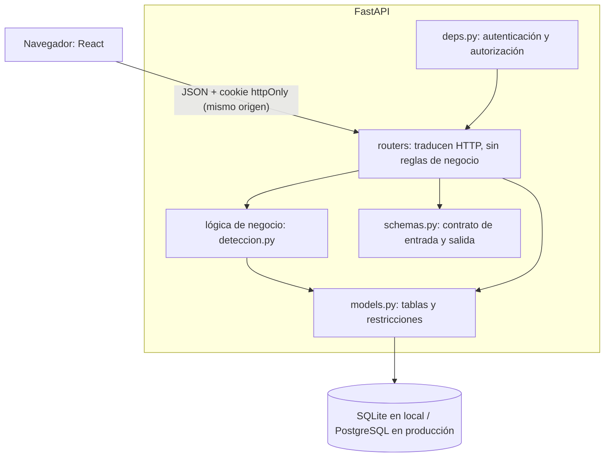

# Arquitectura y prácticas de ingeniería

Define cómo está organizado el portal, qué prácticas seguimos y en qué orden se completa. El contexto general está en [`CONTEXTO_PROYECTO.md`](CONTEXTO_PROYECTO.md) y la justificación del stack y del modelo de datos en [`DECISIONES.md`](DECISIONES.md).

## 1. Criterio general

**La arquitectura debe ser proporcional al problema.** El portal tiene un equipo de una persona, una base de datos y un plazo de días. Cada práctica se adopta solo si reduce un riesgo real o ayuda a explicar el sistema, y cada elemento debe poder justificarse en vivo.

## 2. Arquitectura: monolito modular en capas

Un solo servicio despliega la API y el frontend compilado. Eso da un solo dominio, sin CORS, con un solo deploy, y permite que la cookie `SameSite=Strict` funcione sin configuración adicional.



### Reglas de dependencia

| Capa | Responsabilidad | Lo que no debe hacer |
|---|---|---|
| `routers/` | Recibir la petición, llamar la lógica y armar la respuesta | Contener reglas de negocio |
| `deps.py` | Decidir quién puede hacer qué | Repartir chequeos de permisos por otros archivos |
| `deteccion.py` | Aplicar las reglas de anomalías | Conocer HTTP o lanzar `HTTPException` |
| `schemas.py` | Definir qué entra y qué sale | Exponer campos internos como `password_hash` |
| `models.py` | Definir tablas y restricciones | Contener lógica de presentación |

Las dependencias van en una sola dirección, de arriba hacia abajo. Así se puede probar `evaluar_montos` sin base de datos ni servidor.

### Alternativas descartadas

| Alternativa | Por qué no |
|---|---|
| Microservicios | Añaden red, despliegues y fallos parciales sin ningún beneficio para una persona y un solo dominio |
| Arquitectura hexagonal completa | Sus interfaces y adaptadores solo se justifican si se va a cambiar de infraestructura; SQLAlchemy ya resuelve el cambio de motor |
| Capa de repositorios | Envolvería el ORM sin añadir valor |
| Redux u otro gestor de estado global | El único estado global es la sesión; basta un contexto de React |
| Librería pesada de componentes | La especificación pide CSS propio y sobrio |

## 3. Arquitectura del frontend

```
frontend/src/
  api/          cliente.ts (único punto con fetch) y un archivo por recurso
  sesion/       contexto de sesión y guardia de rutas
  componentes/  piezas reutilizables: Tabla, Severidad, Monto, EstadoCarga, MensajeError
  paginas/      una carpeta por módulo: perfil, directorio, estructura, cierres, alertas
  utils/        formato de montos y fechas, con sus pruebas
```

| Regla | Motivo |
|---|---|
| Solo `api/cliente.ts` llama a `fetch` | El manejo de 401, 403 y errores queda en un solo lugar |
| El menú se arma con `modulos` de `/api/auth/me` | Los permisos los decide el backend, no un rol escrito en el frontend |
| Sin token ni rol en `localStorage` | Lo prohíben las reglas de seguridad de `CLAUDE.md` |
| Los montos siguen siendo texto y se formatean sin `parseFloat` | Evita errores de redondeo con dinero |
| Toda pantalla muestra carga, vacío y error | Evita pantallas en blanco durante la demo |
| Todo campo tiene etiqueta y el foco de teclado es visible | Accesibilidad básica; la severidad usa texto además de color |

**Comparación de transposición:** el backend decide que una alerta es `TRANSPOSICION`. El frontend solo compara los dos textos carácter por carácter y resalta los que difieren, así la regla de negocio no se duplica.

## 4. Diagnóstico del backend actual

**Lo que ya está bien:** autorización centralizada en `deps.py`, reglas de detección como funciones puras, restricciones en la base de datos, montos con `Decimal`, registro y detección en una misma transacción, control de concurrencia con `UPDATE` condicional y 60 pruebas que pasan.

### Por corregir antes del frontend

Estos puntos cambian lo que el frontend recibe o afectan una regla central.

| # | Problema | Evidencia | Corrección |
|---|---|---|---|
| 1 | Los 422 de validación traen `detail` como lista de objetos y en inglés, aunque `CLAUDE.md` promete un mensaje en español. Un comentario de menos de 10 caracteres al gestionar una alerta daría este error | Probado | Manejador de `RequestValidationError` que devuelva un texto en español |
| 2 | Con el frontend compilado, `GET /api/no-existe` responde **200 con HTML** en vez de 404 | Probado | Excluir `/api` de la ruta comodín de `main.py` |
| 3 | `APP_ENV=prod` (mal escrito) no cuenta como producción: quedan activos `/docs` y la semilla sin protección. Además, la app arranca en producción con `COOKIE_SECURE=false` | Probado | `Literal["development", "test", "production"]` y fallar al arrancar si la cookie no es segura en producción |
| 4 | La regla de segregación de funciones está en dos lugares: `_motivo_no_gestionable` y `gestionar_alerta`. Pueden desincronizarse | Lectura del código | Una sola función, usada por ambos |

### Por corregir durante o después del frontend

| # | Problema | Evidencia | Corrección |
|---|---|---|---|
| 5 | `alerta_historial` es de solo inserción por convención: la base de datos permite UPDATE y DELETE | Sin triggers en el DDL | Trigger que rechace esas operaciones. Refuerza la trazabilidad que pide el enunciado |
| 6 | Sin cabeceras CSP ni HSTS | Probado | Añadirlas al integrar el build. Empaquetar la fuente con el frontend simplifica la CSP |
| 7 | Las pruebas solo corren en SQLite, pero producción usa PostgreSQL | `conftest.py` fija SQLite | Permitir otra URL de pruebas y correr la suite en Postgres antes del deploy |
| 8 | Sin linter ni integración continua | No hay configuración | Ruff y GitHub Actions (sección 5) |
| 9 | Sin registro de eventos: logins fallidos y errores 500 no dejan rastro | Sin `logging` en `app/` | `logging` estándar en login, gestión de alertas y errores |
| 10 | `pytest` y `httpx` se instalarían también en producción | `requirements.txt` | Separar `requirements-dev.txt` |

### Limitaciones aceptadas

No se corrigen ahora, pero deben quedar escritas en `DECISIONES.md`. Reconocerlas también demuestra criterio.

- **Bloqueo por intentos:** un correo existente termina respondiendo 429 y uno inexistente nunca, lo que permite deducir qué cuentas existen. Evitarlo requiere limitar por IP.
- **Logout:** borra la cookie, pero el JWT sigue siendo válido hasta expirar. Revocarlo requiere una lista en servidor.
- **Paginación:** los listados no tienen. Es aceptable con 60 cierres, no con datos reales.
- **Migraciones:** el esquema se crea con `create_all`. Con datos reales se usaría Alembic.
- **Fecha futura:** `date.today()` usa la zona horaria del servidor. En uno con UTC, durante las últimas 4 horas del día en Venezuela se aceptaría la fecha de mañana.

## 5. Prácticas de ingeniería

### Calidad de código
- **Ruff** como linter y formateador en Python; **ESLint** y TypeScript en modo `strict` en el frontend.
- **GitHub Actions** ejecuta en cada push: Ruff, pytest, y el lint y el build del frontend. Un flujo pequeño basta.
- Comentarios solo donde haya una decisión de diseño o seguridad, en español.

### Pruebas

Se prueba más donde un error cuesta más:

| Nivel | Qué cubre | Herramienta |
|---|---|---|
| Unidad | Reglas de detección y formato de montos | pytest, Vitest |
| API | Permisos por rol y departamento, segregación y conflictos | pytest con `TestClient` (ya existe) |
| Manual guiada | El recorrido completo de la demo, con cada rol | Lista de la sección 6 |

Cada error corregido se acompaña de una prueba que falle sin la corrección. No se persigue un porcentaje de cobertura.

### Git
- Commits pequeños, en español, que hagan una sola cosa y dejen las pruebas en verde.
- Trabajo por porciones verticales: una pantalla completa con su API, no todas las pantallas a medias.
- Etiqueta `v1.0-entrega` en el commit que se entrega.
- Los documentos se actualizan en el mismo commit que el cambio que describen.

### Seguridad
- Toda ruta nueva usa `requiere_modulo` y, si recibe un departamento, `verificar_departamento`. Toda ruta nueva incluye una prueba de acceso denegado.
- Sin secretos en el repo. Revisar el historial completo antes de hacerlo público.
- Correr `pip-audit` y `npm audit` antes de entregar.

### Uso de IA
- Revisar cada cambio antes del commit y poder explicarlo.
- Pedir primero el plan y sus alternativas cuando la decisión sea de diseño.
- Comprobar ejecutando, no solo leyendo.
- Anotar en `REGISTRO_IA.md` lo aceptado, lo modificado y lo rechazado en el momento en que ocurre.

## 6. Plan de ejecución

Los tiempos son estimados. El orden protege lo obligatorio si el tiempo se acaba.

| Fase | Contenido | Tiempo | Si falta tiempo |
|---|---|---|---|
| 0. Base | Correcciones 1 a 4, regenerar `portal.db`, Ruff y GitHub Actions | 1 a 2 h | Mantener 1 a 4 |
| 1. Esqueleto | Vite, cliente API, sesión, login, menú y manejo de errores | 2 h | Obligatorio |
| 2. Módulos simples | Perfil, directorio y estructura | 2 h | Obligatorio |
| 3. Proceso central | Cierres, alertas, detalle, gestión y vista de transposición | 3 a 4 h | Obligatorio |
| 4. Endurecimiento | Correcciones 5, 6 y 9, responsive | 1 a 2 h | Priorizar la 5 |
| 5. Entrega | README, DECISIONES, REGISTRO_IA, remoto de Git y etiqueta | 1 a 2 h | Obligatorio |
| 6. Ensayo | Presentación, demo y modificación en vivo | 2 h | Obligatorio |
| 7. Deploy | Render y Supabase, con la corrección 7 antes | 1 a 2 h | Se puede omitir |

### Definición de terminado

Una pantalla está terminada cuando:

- Consume la API real.
- Maneja carga, vacío y los errores 401, 403, 409 y 422.
- Se probó con un rol autorizado y con uno no autorizado.
- Funciona con teclado y en pantalla angosta.
- Pasa el lint y el build, y quedó en un commit propio.

### Recorrido de la demo

Es la prueba final; debe funcionar de principio a fin:

1. El jefe de Tesorería registra un cierre con dos dígitos intercambiados y se genera la alerta.
2. El jefe de Tesorería puede ver la alerta, pero no gestionarla.
3. El jefe de Contraloría ve los dígitos resaltados y la gestiona con un comentario.
4. El historial muestra quién, cuándo y qué cambió.
5. Una segunda gestión de la misma alerta se rechaza.
6. Un colaborador solo ve su información limitada, y una llamada directa a la API también le responde 403.
