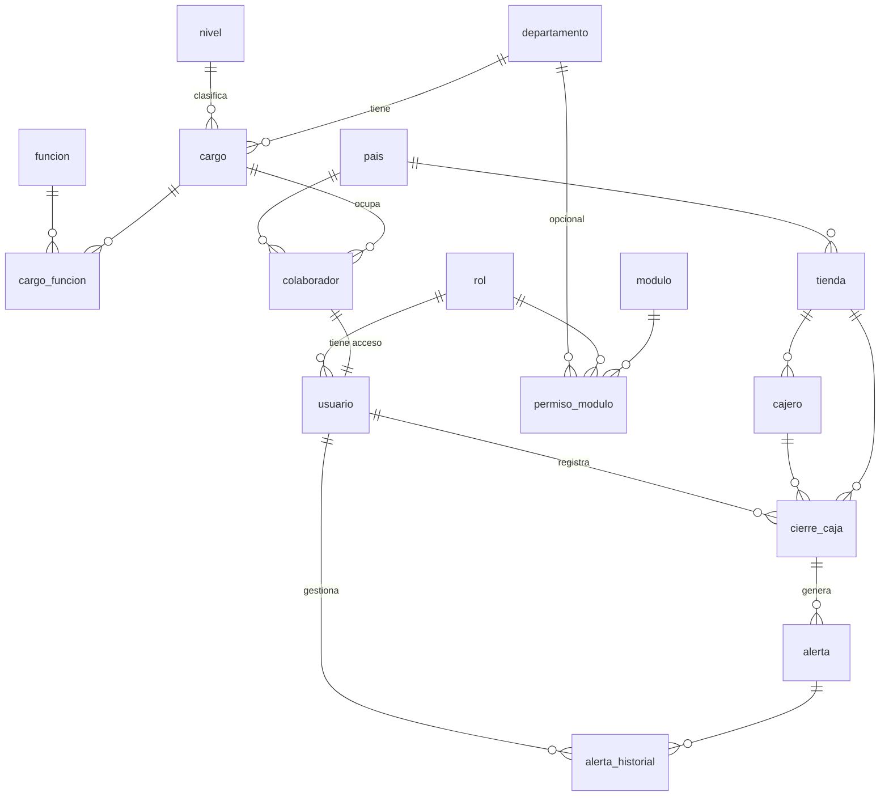

# Documento de decisiones técnicas

> Estado: backend completo. Falta agregar la sección del frontend (Paso 4) y el deploy (Paso 6).

## 1. Stack elegido y por qué

| Decisión | Alternativas consideradas | Por qué |
|---|---|---|
| **Python + FastAPI** | Flask, Node/Express, Spring Boot | Valida la entrada con tipos (Pydantic), genera documentación interactiva en `/docs` para probar la API sin frontend y es fácil de leer para alguien que no es experto en backend. |
| **SQLAlchemy 2.0 (ORM)** | SQL escrito a mano | Consultas parametrizadas por defecto (sin inyección SQL) y el mismo código funciona en SQLite y PostgreSQL. |
| **SQLite en local, PostgreSQL en producción** | Solo SQLite / solo Postgres | SQLite no requiere instalar nada para revisar el proyecto. Postgres en producción porque guarda `NUMERIC` exacto y soporta concurrencia real. Se cambia solo con `DATABASE_URL`. |
| **React + TypeScript** | Angular, Vue | Es la tecnología que mejor conozco: la he usado en diversos proyectos, y eso me permite explicar y modificar el código con seguridad. Su modelo de componentes permite armar las pantallas con piezas reutilizables, es intuitivo y versátil para integrarlo con otras tecnologías. TypeScript agrega comprobación de tipos sobre los datos que llegan de la API. |
| **Deploy: un solo servicio** | Front y back separados | FastAPI sirve el frontend compilado: un solo dominio, sin CORS, un solo deploy. |

El criterio principal para elegir el stack fue la **facilidad de desplegarlo y explicarlo**.

## 2. Modelo de datos

El DDL completo está en `database/schema_postgresql.sql`.

### Decisiones de normalización
- **El colaborador no guarda su departamento.** Lo obtiene a través de su cargo (`colaborador → cargo → departamento`). Guardarlo en los dos lugares permitiría que un colaborador figure en Tesorería con un cargo de Contabilidad.
- **Funciones como relación N:M** (`cargo_funcion`): un cargo tiene varias funciones y una misma función ("Elaborar reportes de gestión para la Vicepresidencia") aparece en varios cargos sin repetirse.
- **Nivel y país como catálogos**, no texto libre: evita "Sr", "Senior" y "senior" como tres valores distintos.
- **Usuario separado de colaborador:** las credenciales no se mezclan con datos de RR. HH., y no todo colaborador necesita acceso.
- **No se guardan datos derivables:** la diferencia de un cierre se calcula (`declarado − sistema`); quién gestionó una alerta se obtiene del historial.
- **Excepción deliberada:** `cierre_caja.tienda_id` se guarda aunque el cajero ya tenga tienda, porque es un **hecho histórico**: si el cajero cambia de tienda, sus cierres pasados no deben moverse con él.
- Del dataset original se eliminaron las columnas `cargo` y `unidad_organizativa` de `cajeros`, porque tenían el mismo valor en todas las filas.
- Montos en `NUMERIC(12,2)`, nunca `float`.
- Restricciones en la BD (no solo en el código): `CHECK` de estados y montos ≥ 0, `UNIQUE(cierre_id, regla)` en alertas, llaves foráneas activadas también en SQLite.

## 3. Proceso de negocio elegido: detector de anomalías en cierres de caja

**Por qué este y no notas de crédito:**
1. Tiene **lógica de negocio real** más allá de un flujo de estados: hay que diseñar reglas, calibrarlas con los datos y justificar umbrales.
2. Los datos traen patrones verificables: transposiciones, cajeros reincidentes y cierres duplicados. Eso permite demostrar que el sistema funciona con un resultado concreto (28 alertas).
3. El caso de notas de crédito tiene una **contradicción** entre el enunciado ("quien solicita no puede autoaprobar", "auditoría de quién") y el README del dataset ("no registres quién ejecutó"). Habría que resolverla con el negocio antes de construir.

### Reglas y calibración

| Regla | Lógica | Calibración |
|---|---|---|
| Transposición | Los montos son iguales salvo dos dígitos **vecinos** intercambiados | Se compara dígito a dígito. Que la diferencia sea múltiplo de 9 es **necesario pero no suficiente** (6.947,75 vs 6.767,75 difieren 180 y no es transposición). Se evalúa antes que la tolerancia: el cierre #58 difiere solo 9,00. |
| Fuera de rango | \|diferencia\| > tolerancia | El ruido normal del dataset llega a 4,81, así que la tolerancia es 10,00. Severidad: ≥2 % media, ≥10 % o ≥500 alta. **Un faltante sube un nivel**: que falte dinero es más grave que un sobrante. |
| Duplicado | Segundo cierre del mismo cajero el mismo día | El README del dataset dice que hay uno por cajero y día, pero hay 6 casos. No se rechazan: se alertan, porque podrían ser turnos dobles (pregunta abierta para el negocio). |
| Reincidencia | ≥3 cierres anómalos del cajero en 30 días | Las alertas **descartadas** (falsos positivos) no cuentan. |

Los umbrales están en la tabla `parametro_deteccion`, no fijos en el código.

### Flujo y control interno
1. **Tesorería registra** el cierre. La detección corre en la misma transacción: si falla, no queda un cierre sin evaluar.
2. **Contraloría gestiona** cada alerta: `pendiente → revisada | descartada`, con comentario obligatorio.
3. Cada cambio queda en `alerta_historial` (solo inserción): quién, cuándo, estado anterior y nuevo, comentario.
4. **Segregación de funciones:** quien registró un cierre no puede gestionar sus alertas, ni siquiera el Admin.
5. **Concurrencia:** la gestión usa un `UPDATE ... WHERE estado = 'pendiente'`. Si dos personas gestionan la misma alerta a la vez, solo una lo logra; la otra recibe 409.

## 4. Decisiones de seguridad

| Riesgo | Medida |
|---|---|
| Robo de sesión por XSS | JWT en **cookie httpOnly** (JavaScript no puede leerla), nunca en `localStorage`. |
| CSRF | Cookie `SameSite=Strict` y mismo origen para front y API. |
| Permisos manipulados en el cliente | El token solo lleva el ID; **rol y departamento se leen de la BD en cada request**. Desactivar a alguien corta su acceso de inmediato. |
| Acceso indebido | Toda ruta pasa por `deps.py`: ¿quién eres? (401) → ¿tienes el módulo? (403) → ¿es tu departamento? (403). Cubierto con pruebas automáticas que llaman la API directamente. |
| Fuerza bruta | Bloqueo de 15 minutos tras 5 intentos fallidos. |
| Enumeración de usuarios | Mismo mensaje para correo inexistente y contraseña errada; hash señuelo para igualar el tiempo de respuesta. |
| Contraseñas filtradas | bcrypt con sal (12 rondas). |
| Token falsificado | Algoritmo fijado a HS256 (se rechaza `alg=none`); secreto ≥32 caracteres obligatorio. |
| Secretos en el repo | `.env` en `.gitignore`; `.env.example` documenta las variables sin valores. |
| Datos de prueba borrados en producción | La semilla se niega a correr con `APP_ENV=production` salvo con `--force-production`. |
| Inyección SQL | ORM con consultas parametrizadas. |
| Exposición de datos | Los esquemas de salida listan campos explícitos (nunca `password_hash`); `/docs` deshabilitado en producción; cabeceras `nosniff`, `X-Frame-Options: DENY`, `Cache-Control: no-store`. |
| Datos personales | 100 % ficticios; correos en el dominio reservado `.example`. |

## 5. Limitaciones conocidas y qué haría con más tiempo

- **SQLite guarda `NUMERIC` como decimal aproximado (`REAL`).** Se mitiga redondeando a 2 decimales al leer; en PostgreSQL no ocurre.
- **El bloqueo por intentos es por cuenta, no por IP.** Con más tiempo agregaría un límite por IP (rate limiting) y alertas de seguridad.
- No hay renovación de sesión (refresh token): al expirar (60 min) hay que volver a entrar.
- Los umbrales de detección se leen de la BD pero aún no se editan desde el portal; requeriría auditar también esos cambios.
- La regla de reincidencia no se recalcula hacia atrás si una alerta se descarta después.
- Los montos no tienen moneda: las tiendas de Venezuela y Argentina se comparan con la misma tolerancia absoluta. Con datos reales, la tolerancia debería depender de la moneda o ser porcentual.
- Las reglas son deterministas. Con historial suficiente, se podría agregar detección estadística (desviación respecto al comportamiento habitual de cada cajero o tienda).
- Pregunta para el negocio: ¿un cajero puede tener más de un turno por día? Si sí, falta un campo `turno` y la regla de duplicado cambiaría.
